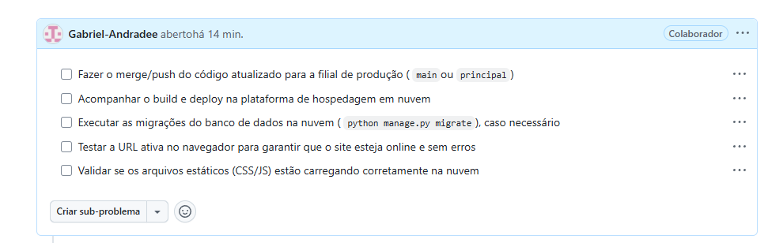
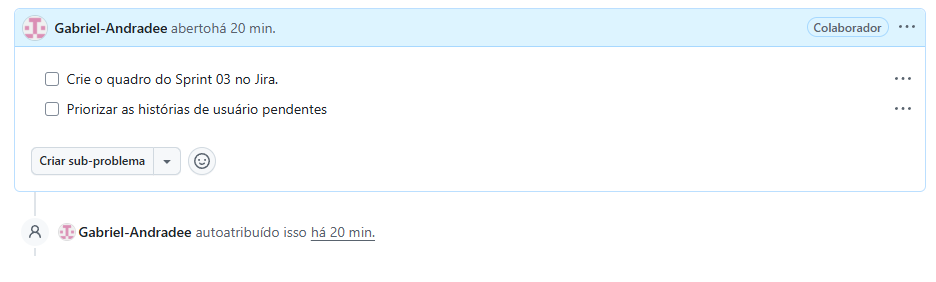

# ESGfy


## Descrição
Aplicação web focada para reforçar e ensinar a importancia da tecnica de  ESG em pequenas e medias empresas 


### 🛠️ Tecnologias Usadas


[](https://render.com)


## 👥 Integrantes do Projeto

<div align="center">

|Membro | E-mail |
| :---: | :---: |
|João Gabriel | **jgfa@cesar.school** |
|João Rafael da Silva Guedes Alcoforado | **jrsga@cesar.school** |
|Joel Costa Oliveira  | **jco@cesar.school** |
|Lucas Cabral Lapa| **lcl4@cesar.school** |
|Marco Antonio Veras Sanson e Souza| **mavss@cesar.school** |
|Rafael Costa e Silva | **rcs9@cesar.school** |

</div>
## 🚀 Guia de Instalação e Execução (Como Preparar o Ambiente)

Siga os passos abaixo para configurar e rodar o projeto localmente em sua máquina:

### 1. Pré-requisitos
* Ter o **Python** (versão 3.10 ou superior) instalado.
* Ter o **Git** instalado.

### 2. Clonando o Repositório
Abra o seu terminal e execute o comando abaixo para clonar o projeto:
```bash
git clone https://github.com/joaorafaelsga/Projeto_FDS.git
cd Projeto_FDS
python -m venv venv
.\venv\Scripts\Activate
pip install -r requirements.txt
python manage.py makemigrations
python manage.py migrate
python manage.py runserver
```

## Entregas do Projeto

###  Entrega 1:

- **[Documento de Análise de Competidores](https://github.com/joaorafaelsga/Projeto_FDS/blob/main/Analise_de_competidores.md)


###  Entrega 2:
## 🚀 Acesso à Aplicação (Deployment)
A aplicação encontra-se hospedada e em funcionamento ativo na nuvem:
* **URL de Produção:** [https://projeto-fds-qltf.onrender.com](https://projeto-fds-qltf.onrender.com)

## 🎥 Vídeos de Demonstração e Explicação
* **Vídeo 1 (Demonstração da Aplicação na Nuvem):** [https://youtu.be/JiSO4DgVdYI]
* **Vídeo 2 (Explicação do Código e Arquitetura):** [https://youtu.be/4Kz_H4hgz3Q?si=vF9Zc03DT8fbHM0w]
* **Backlog da Sprint 2** **** 


###  Entrega 3:
### 📄 Histórias de Usuário e BDD
* 🔗 **[Documento de Histórias de Usuário e BDD](./HISTORIAS.md)**
<table>
  <tr>
    <td width="33%" valign="top" bgcolor="#fff9c4">
      <strong>US02 — Fale Conosco</strong>
      <p><strong>Como</strong> usuário ou visitante da plataforma,<br>
      <strong>Quero</strong> enviar mensagens pelo formulário Fale Conosco,<br>
      <strong>Para</strong> obter atendimento e registrar feedbacks.</p>
    </td>
    <td width="33%" valign="top" bgcolor="#e3f2fd">
      <strong>US03 — Navegação institucional</strong>
      <p><strong>Como</strong> visitante da plataforma,<br>
      <strong>Quero</strong> acessar as páginas Quem Somos, Sobre a Empresa e Sobre o Projeto,<br>
      <strong>Para</strong> conhecer a metodologia, os objetivos do ESGfy e a equipe.</p>
    </td>
    <td width="33%" valign="top" bgcolor="#fce4ec">
      <strong>US04 — Diagnóstico ESG</strong>
      <p><strong>Como</strong> gestor da empresa,<br>
      <strong>Quero</strong> visualizar perguntas e diretrizes dos pilares Ambiental, Social e Governança,<br>
      <strong>Para</strong> identificar em quais pilares a empresa pode melhorar.</p>
    </td>
  </tr>
</table>

###  Entrega 4:


Acompanhamento e gestão de tarefas do projeto:





